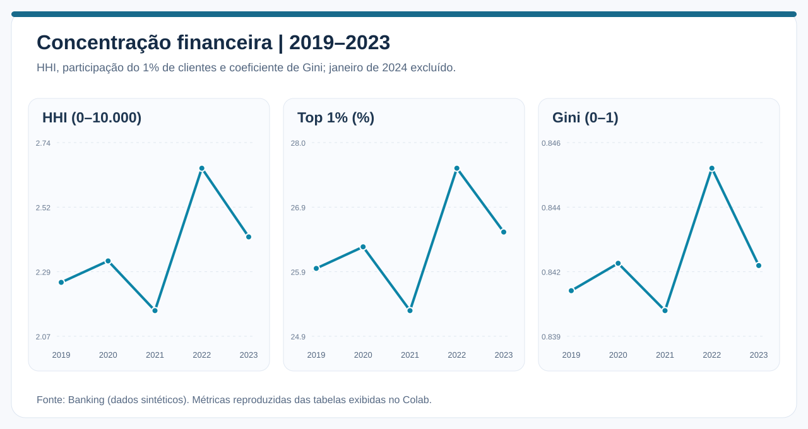
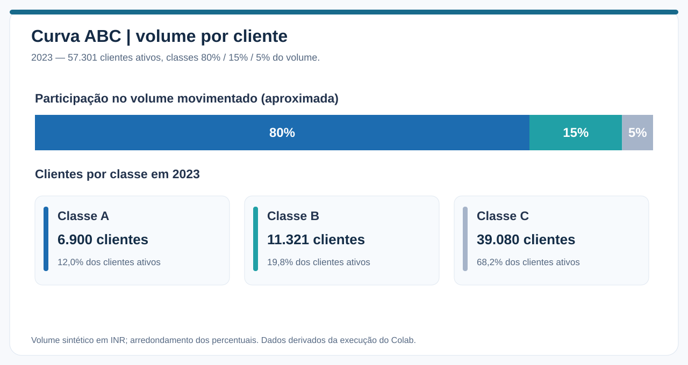
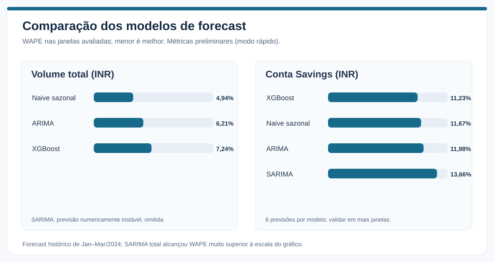
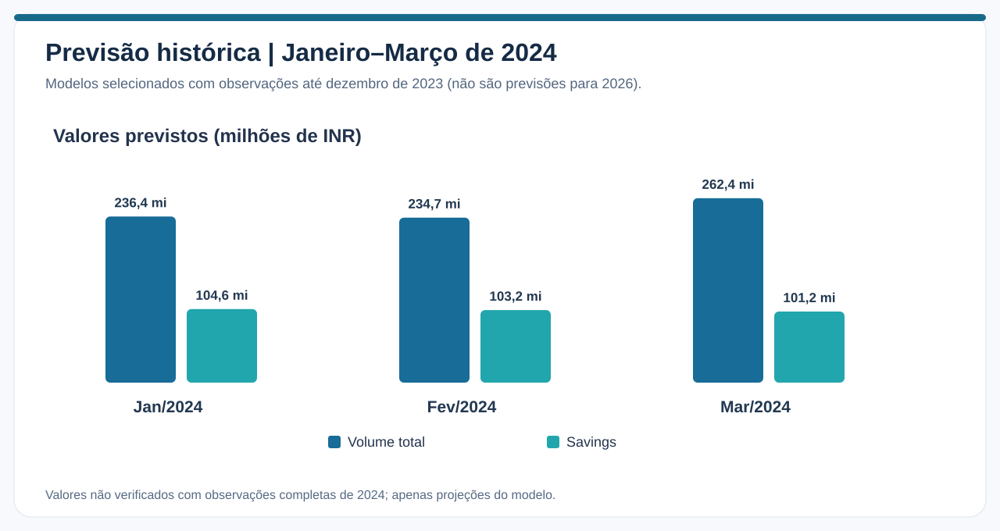
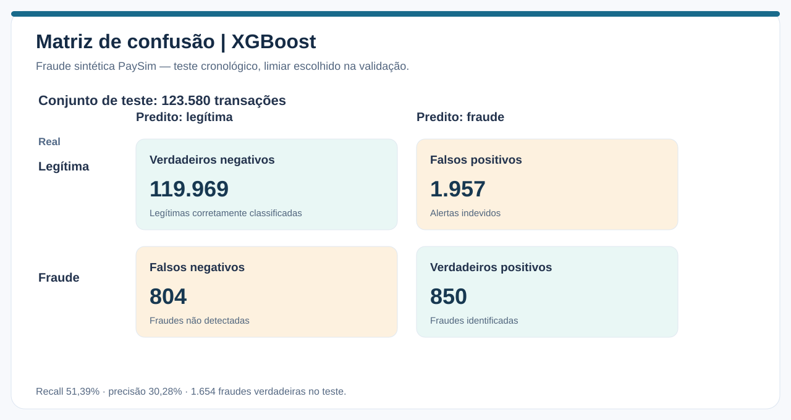
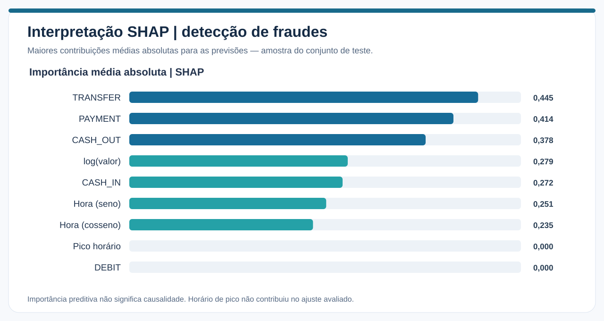
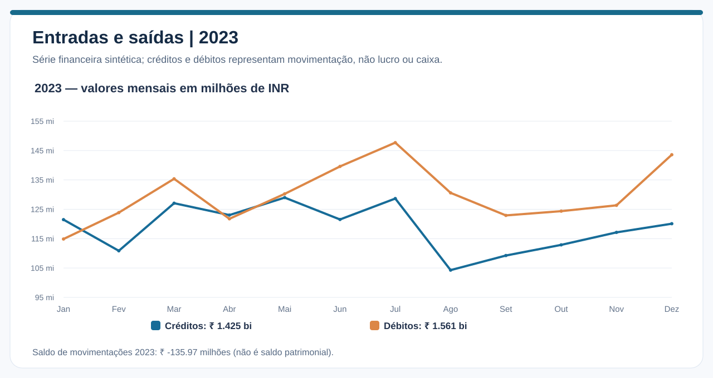
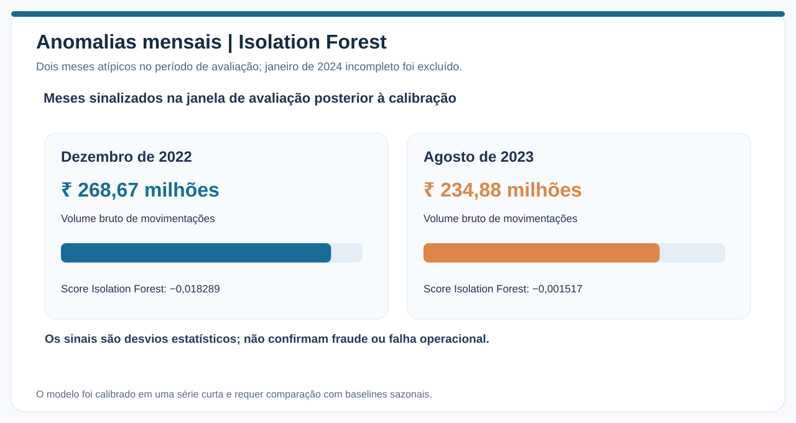

# Financial Transaction Intelligence

### Concentração de clientes · Forecast financeiro · Detecção de fraudes · Machine Learning

**Python · Pandas · Scikit-learn · Statsmodels · XGBoost · SHAP · Matplotlib**

> **Descrição:** análise de datasets financeiros sintéticos com Python, estatística e Machine Learning. O projeto investiga Curva ABC, concentração de clientes, forecasting, fluxos transacionais, anomalias e detecção de fraudes — com resultados ilustrados, métricas, metodologia e notebooks reproduzíveis.

## Visão geral

O **Financial Transaction Intelligence** é um projeto de **Data Analytics e Data Science** que estuda o comportamento das movimentações financeiras, a concentração do volume entre clientes e a capacidade de prever transações e identificar fraudes simuladas.

O foco é responder a perguntas de negócio com análises documentadas: **o que os dados mostram, como os modelos foram avaliados, quais resultados são úteis e onde estão as limitações**. Não depende de um dashboard externo — as evidências estão nos **gráficos**, nos **relatórios** e nos **notebooks Python** disponíveis neste repositório.

### Perguntas de negócio

- A movimentação financeira está ficando cada vez mais dependente de poucos clientes?
- Como a Curva ABC e o clustering ajudam a entender o comportamento dos clientes?
- Quais segmentos podem ser previstos com menor erro: modelos estatísticos ou Machine Learning?
- Quais tipos e valores de operações aparecem associados às fraudes simuladas?
- Quais períodos são estatisticamente atípicos e exigem investigação?

## Fontes e recorte

| Dataset | Registros originais | Uso no projeto |
|---|---:|---|
| [Banking Transactions 2019–2024 — Kaggle](https://www.kaggle.com/datasets/belbino/indian-banking-transactions-20192024) | 550.000 | Concentração, ABC, clustering, forecast e fluxos financeiros |
| [PaySim — Kaggle](https://www.kaggle.com/datasets/ealaxi/paysim1) | 6.362.620 | Classificação de fraudes, análise temporal e explicabilidade |

No Banking foram analisadas **505.980 transações válidas de 2019 a 2023**, envolvendo **79.866 clientes distintos no recorte**. As **267 transações de janeiro de 2024** que restavam após os filtros foram excluídas porque o mês estava incompleto, o que distorcia comparações e previsões.

O PaySim contém **8.213 fraudes simuladas** e **743 etapas horárias**. Os dois datasets representam **universos independentes**: não existem clientes comuns identificados, períodos diretamente comparáveis nem unidade monetária compartilhada. **Os valores das duas bases não são somados nem unidos por cliente.**

## Principais resultados

### 1. Concentração financeira e clientes

A movimentação anual ficou em torno de **₹ 3 bilhões** entre 2019 e 2023. Em 2023, os **6.900 clientes da classe A** — cerca de **12% dos clientes ativos** — foram responsáveis por aproximadamente **80% do volume**.

O **Gini próximo de 0,84** revela desigualdade expressiva na distribuição do volume, mas o HHI e a participação do Top 1% **não apresentaram uma trajetória contínua de aumento**.

O clustering identificou dois perfis descritivos com diferenças de ticket, frequência e recência. A estabilidade desses grupos ainda requer validação complementar.

**[Ler análise completa de concentração, Curva ABC e clusters](analyses/01_concentracao_financeira.md)**

### 2. Forecast por segmentos financeiros

Na avaliação em modo rápido, o **Naive sazonal** atingiu **WAPE de 4,94%** na série total; no segmento **Savings**, o **XGBoost** obteve **11,23%**. As diferenças foram avaliadas com **duas origens temporais e seis observações por modelo/segmento**, portanto são **resultados preliminares**.

O **SARIMA** mostrou instabilidade numérica severa na série total. O projeto mantém essa falha documentada em vez de ocultá-la.

As previsões exibidas referem-se a **jan–mar/2024**, geradas com dados até dezembro de 2023; **não são previsões atuais nem projeções para 2026**.

**[Ler análise completa de forecast por segmentos](analyses/02_forecast_segmentos.md)**

### 3. Detecção preditiva de fraudes

O **XGBoost** alcançou **ROC-AUC de 0,9408**, **Average Precision de 0,3580**, **precisão de 30,28%** e **recall de 51,39%** no teste cronológico do PaySim. O modelo detectou **850 das 1.654 fraudes** presentes no teste, mas deixou **804 fraudes sem detectar** e gerou **1.957 alertas incorretos**.

As variáveis de tipo de operação e valor tiveram grande contribuição para as previsões. O recall caiu para aproximadamente **19,42% nos horários classificados como pico**.

**Ressalva:** a escolha final entre modelos utilizou a AP do teste e ainda precisa ser deslocada para a validação, preservando a avaliação final independente.

**[Ler análise completa de fraude, subgrupos e SHAP](analyses/03_deteccao_fraudes.md)**

### 4. Fluxo financeiro, sazonalidade e anomalias

Em 2023, os gráficos mostram aproximadamente **₹ 1,425 bilhões em créditos** e **₹ 1,561 bilhões em débitos**. A diferença de movimentações é de aproximadamente **−₹ 135,97 milhões**; **isso não representa prejuízo, lucro ou saldo bancário**, pois não há reconciliação contábil.

O **SARIMA** apresentou **WAPE de 6,90%** para créditos, enquanto o **Naive sazonal** obteve **6,49%** para débitos. A estabilidade desses resultados ainda precisa ser confirmada em mais janelas.

O **Isolation Forest** sinalizou **dezembro de 2022 e agosto de 2023** como meses atípicos na janela posterior à calibração. Um alerta estatístico **não é prova de fraude**.

**[Ler análise completa de fluxo, previsões e anomalias](analyses/04_fluxo_anomalias.md)**

## Análises

| Estudo | Entrega |
|---|---|
| **[01 — Concentração, Curva ABC e clustering](analyses/01_concentracao_financeira.md)** | Indicadores HHI/Gini, classes ABC e perfis de clientes |
| **[02 — Forecast por segmentos](analyses/02_forecast_segmentos.md)** | Comparação ARIMA/SARIMA/XGBoost/Naive e backtesting |
| **[03 — Detecção de fraudes](analyses/03_deteccao_fraudes.md)** | Classificadores, Precision/Recall, matriz de confusão e SHAP |
| **[04 — Fluxo e anomalias](analyses/04_fluxo_anomalias.md)** | Créditos, débitos, sazonalidade, forecast e Isolation Forest |
| **[Metodologia, rastreabilidade e limitações](analyses/metodologia_limitacoes.md)** | Fontes, preparação, prevenção de leakage e pendências de validação |

## Reproduzir o projeto

Os quatro notebooks estão em **[`notebooks/`](notebooks/)**, organizados por tema. Cada um contém **um único título inicial e células de código**, sem blocos de explicação entre as análises. As dependências estão em [`requirements.txt`](requirements.txt).

Os notebooks da branch de desenvolvimento incluem preparação opcional para **Google Colab**, com download direto dos arquivos correspondentes do Kaggle. O modo `FINANCE_BI_FAST_TEST=1` diminui o esforço computacional; para testar mais modelos e janelas, defina `FINANCE_BI_FAST_TEST=0` e revise os resultados.

Os dados brutos não são versionados neste GitHub por seu tamanho. As [métricas resumidas apresentadas no Colab](assets/data/metricas_colab.json) e as figuras SVG permitem conferir os principais números. As imagens foram **redesenhadas a partir das saídas exibidas no Colab**, e não extraídas de um painel externo. O relatório metodológico detalha as limitações de precisão decorrentes de arredondamentos.

## Escopo e limitações

- **Dados inteiramente sintéticos:** os resultados não medem risco real de uma instituição financeira e não devem fundamentar decisões de produção.
- **Validação preditiva limitada:** forecast com poucas origens em modo rápido e casos de instabilidade numérica do SARIMA.
- **Classificação de fraudes:** a prevalência muda entre treino, validação e teste; a seleção do modelo final precisa ser feita sem consultar o teste.
- **Clustering:** os grupos descrevem perfis, mas ainda exigem avaliação de estabilidade.
- **Anomalias:** meses atípicos foram sinalizados sem rótulos de confirmação; não se pode afirmar fraude ou irregularidade.

Consulte **[Metodologia e limitações](analyses/metodologia_limitacoes.md)** antes de interpretar as métricas como resultados conclusivos.

---

**Financial Transaction Intelligence — projeto de portfólio em Data Analytics e Data Science, com código, análises, imagens e resultados rastreáveis.**
