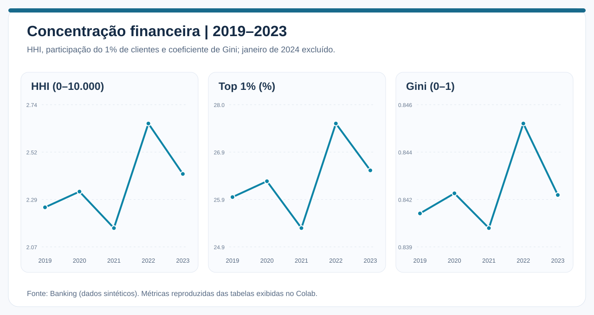
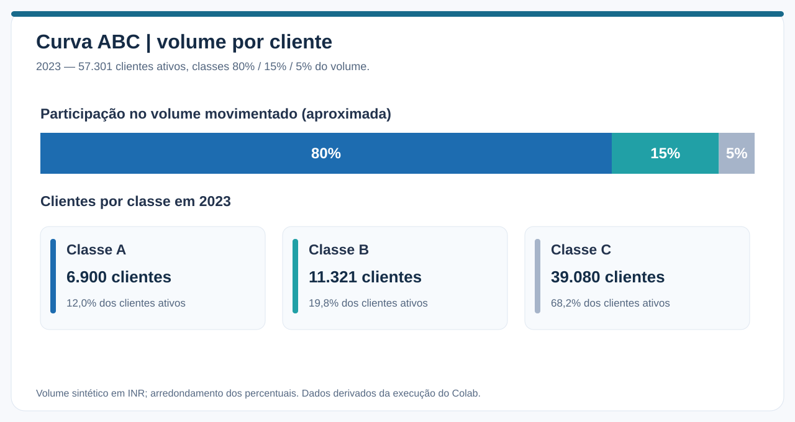
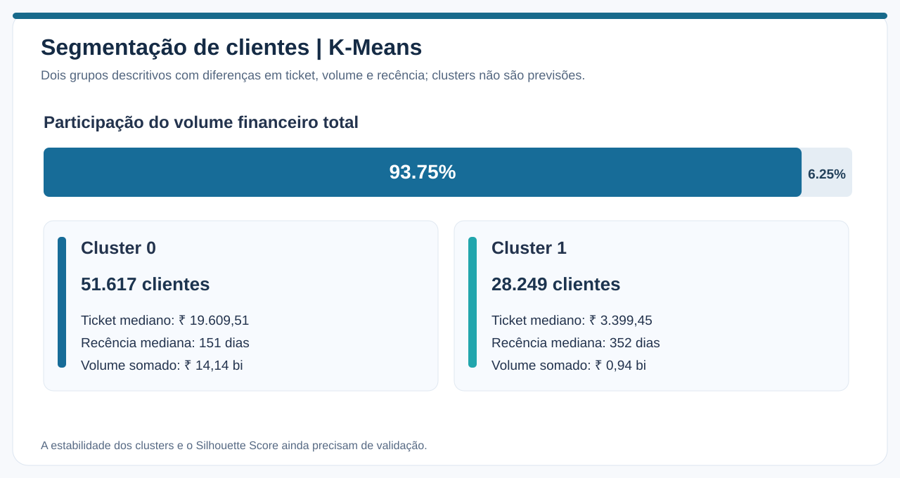

# Concentração financeira, Curva ABC e segmentação de clientes

> **Pergunta de negócio:** a movimentação financeira está ficando mais dependente de poucos clientes ao longo dos anos?

**Fonte:** [Banking Transactions 2019–2024, Kaggle](https://www.kaggle.com/datasets/belbino/indian-banking-transactions-20192024). Os registros são **sintéticos**; os valores financeiros desta análise estão em **rúpias indianas (INR)**. Para evitar uma falsa queda de movimentação, o mês parcial de janeiro de 2024 (267 registros após filtros) foi removido. A análise utiliza **505.980 transações válidas**, **79.866 clientes distintos** e os **cinco anos completos de 2019 a 2023**.

## Visão executiva

O volume financeiro anual permaneceu perto de **₹ 3 bilhões**, com oscilações moderadas e sem uma tendência contínua de crescimento. A distribuição do volume é desigual entre os clientes (Gini perto de **0,84**), mas a participação dos maiores clientes e o HHI variaram relativamente pouco no período. Em 2023, **6.900 dos 57.301 clientes ativos (12,04%)** movimentaram aproximadamente **80% do valor total**.

## Evolução anual

| Ano | Volume (INR) | Transações | Clientes ativos | HHI | Gini | Top 1% |
|---|---:|---:|---:|---:|---:|---:|
| 2019 | ₹ 3,007 bi | 101.294 | 57.515 | 2,257 | 0,8409 | 25,96% |
| 2020 | ₹ 3,036 bi | 101.152 | 57.321 | 2,332 | 0,8418 | 26,31% |
| 2021 | ₹ 2,991 bi | 101.247 | 57.500 | 2,159 | 0,8402 | 25,28% |
| 2022 | ₹ 3,062 bi | 101.385 | 57.322 | 2,655 | 0,8451 | 27,58% |
| 2023 | ₹ 2,987 bi | 100.902 | 57.301 | 2,416 | 0,8417 | 26,55% |

O volume de 2023 ficou cerca de **0,68% abaixo de 2019**; em relação a 2022, a redução foi de aproximadamente **2,45%**. Os valores representam **movimentação**, não receita, faturamento ou lucro da instituição.

O **HHI** foi calculado como `10.000 × soma(participação individual do cliente²)`. Ele quantifica a concentração do **volume transacional dentro do conjunto de clientes**; não representa HHI de concentração de mercado. Seu valor foi de 2,257 em 2019 e 2,416 em 2023. Um aumento modesto entre os extremos, com pico intermediário em 2022, **não caracteriza uma tendência crescente contínua**.

O **Gini** ficou entre aproximadamente **0,840 e 0,845**. Isso mostra distribuição muito desigual do volume transacionado. A aparente diferença entre Gini alto e HHI baixo é possível: muitos clientes têm parcelas pequenas, enquanto milhares de outros — não apenas um ou dois — concentram a movimentação.

## Curva ABC

| Classe | Clientes em 2023 | Fração dos clientes | Volume (INR) | Fração do volume (aprox.) |
|---|---:|---:|---:|---:|
| A | 6.900 | 12,04% | ₹ 2,389 bi | 80% |
| B | 11.321 | 19,76% | ₹ 0,448 bi | 15% |
| C | 39.080 | 68,20% | ₹ 0,149 bi | 5% |

A ordenação é feita pelo volume anual por cliente. O algoritmo classifica pela parcela acumulada **antes** da inclusão do cliente; portanto, o cliente que cruza cada limite pode fazer a classe exceder ligeiramente 80% ou 95%. Os percentuais ilustrados são arredondados.

A Curva ABC descreve **concentração transacional**; ela não mede diretamente receita gerada pelo cliente, rentabilidade, saldo disponível ou risco de inadimplência. Uma próxima análise interessante seria uma **matriz de migração ABC entre anos**, identificando permanência, entrada e saída de clientes das classes.

## Clustering descritivo

O K-Means separou os clientes em dois perfis de movimentação. A classe de cada cliente é calculada sobre o conjunto agregado de 2019–2023, **não em cada ano isoladamente**.

| Medida | Cluster 0 | Cluster 1 |
|---|---:|---:|
| Clientes | 51.617 | 28.249 |
| Volume total aproximado | ₹ 14,139 bi | ₹ 0,943 bi |
| Ticket mediano | ₹ 19.609,51 | ₹ 3.399,45 |
| Recência mediana | 151 dias | 352 dias |
| Transações medianas | 7 | 4 |

O Cluster 0 reúne **64,63%** dos clientes e cerca de **93,75%** do volume agregado, refletindo maior ticket, atividade e frequência. O Cluster 1 apresenta menor movimentação e maior intervalo mediano desde a última transação.

Esses grupos são úteis para formular hipóteses sobre engajamento e atividade, **não** para atribuir causalmente valor ao cliente nem para prever abandono. O notebook utiliza Silhouette Score na escolha do número de grupos, mas a saída apresentada não inclui os scores e tampouco um teste de estabilidade das partições. A qualidade do clustering permanece **pendente de verificação adicional**.

## Conclusões e possíveis aplicações

A pergunta de negócio recebe uma resposta **limitada ao período de 2019–2023**: existe concentração relevante no volume agregado, porém **não foi demonstrada uma dependência crescente e contínua de poucos clientes**. Seria útil acompanhar (i) a permanência dos clientes de maior volume, (ii) a migração entre classes ABC, (iii) a volatilidade por classe e (iv) o peso da atividade de grupos recém-criados.

## Reprodutibilidade e limitações

- [Notebook 01 — execução e código](../notebooks/01_concentracao_abc_clustering.ipynb)
- [Métricas transcritas dos resultados do Colab](../assets/data/metricas_colab.json)
- [Metodologia e limitações do projeto](metodologia_limitacoes.md)

**Escopo validado:** execução com CSV do Kaggle, filtros, tabelas ABC, HHI/Gini e clustering. **Pendente:** avaliação quantitativa de estabilidade dos clusters e auditoria detalhada de exclusões de registros. Os gráficos SVG foram redesenhados a partir dos resultados apresentados no Colab; não substituem a execução dos notebooks.
