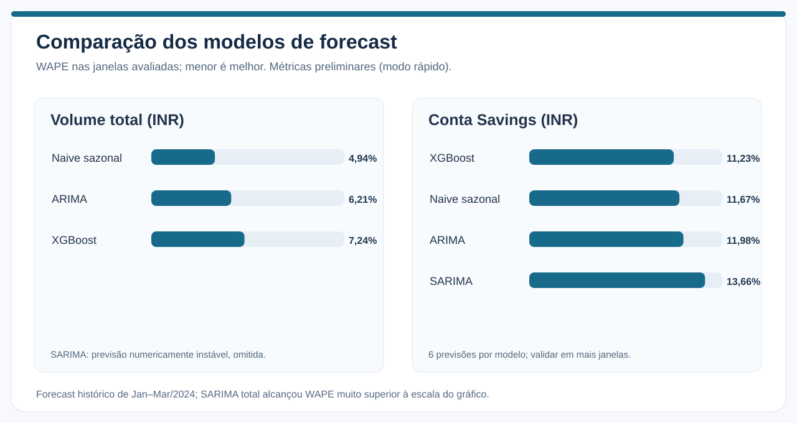
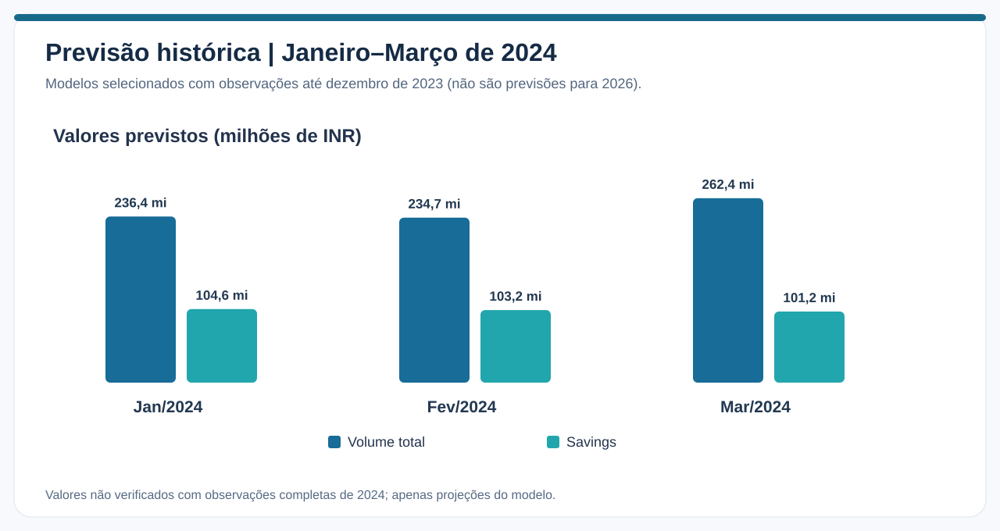

# Forecast financeiro por segmentos — ARIMA, SARIMA e XGBoost

> **Pergunta de negócio:** quais segmentos têm movimentações mais previsíveis, e modelos complexos superam uma referência sazonal simples?

**Fonte:** [Banking Transactions 2019–2024 — Kaggle](https://www.kaggle.com/datasets/belbino/indian-banking-transactions-20192024), com **60 meses completos** de janeiro de 2019 a dezembro de 2023. Valores em **INR**. Janeiro de 2024 foi excluído por estar incompleto.

## Resumo dos resultados

No modo rápido (`FINANCE_BI_FAST_TEST=1`), foram avaliadas apenas duas séries: **TOTAL** e **tipo_conta:Savings**. O backtesting usou **duas origens cronológicas** e três meses de horizonte para cada origem: **seis observações previstas por modelo e segmento**. Não é suficiente para comprovar superioridade estatística estável.

| Segmento | Modelo | MAE aproximado | WAPE |
|---|---|---:|---:|
| TOTAL | Naive sazonal | ₹ 12,41 mi | **4,94%** |
| TOTAL | ARIMA | ₹ 15,61 mi | 6,21% |
| TOTAL | XGBoost | ₹ 18,19 mi | 7,24% |
| TOTAL | SARIMA | ₹ 11,75 trilhões | **4.673.089,78%** |
| Savings | XGBoost | ₹ 11,37 mi | **11,23%** |
| Savings | Naive sazonal | ₹ 11,81 mi | 11,67% |
| Savings | ARIMA | ₹ 12,13 mi | 11,98% |
| Savings | SARIMA | ₹ 13,82 mi | 13,66% |

**WAPE** = soma dos erros absolutos ÷ soma dos valores observados; **MAE** = média dos erros absolutos. Menor é melhor, quando avaliados em janelas comparáveis. O WAPE extremo do SARIMA no segmento total é apresentado deliberadamente — **não foi ocultado nem interpretado como resultado normal**.

### Segmento TOTAL

A referência **Naive sazonal** venceu os modelos mais complexos na amostra de validação. Isso significa apenas que, para as janelas observadas, o padrão correspondente do ano anterior foi uma referência competitiva. A diferença de WAPE entre Naive (4,94%) e ARIMA (6,21%) corresponde a **1,27 ponto percentual**, não a evidência de estabilidade futura.

### Segmento Savings

O **XGBoost** registrou o menor WAPE observado (11,23%), mas a vantagem sobre o Naive sazonal (11,67%) foi de **0,44 ponto percentual**. A proximidade dos resultados pede backtesting mais abrangente antes de recomendar complexidade adicional.

## Projeção histórica para 2024

| Mês previsto | TOTAL (INR) | Savings (INR) |
|---|---:|---:|
| Jan/2024 | ₹ 236,36 mi | ₹ 104,65 mi |
| Fev/2024 | ₹ 234,73 mi | ₹ 103,24 mi |
| Mar/2024 | ₹ 262,45 mi | ₹ 101,19 mi |

Esses valores foram gerados a partir do histórico terminado em **dezembro de 2023**. São **projeções históricas para testar os modelos**, não previsões para 2026. Como não há meses completos de 2024 na amostra utilizada, as projeções acima não foram comparadas com valores reais completos de 2024.

## Metodologia

1. Filtrar transações concluídas e não negativas, validar datas e remover períodos de borda incompletos.
2. Agregar `transaction_amount` por mês e segmento, sem agregar valores do PaySim.
3. Identificar segmentos por histórico anterior à janela de backtesting (prevenção de vazamento de informação).
4. Para cada origem, treinar somente com valores passados e gerar três previsões recursivas.
5. Comparar Naive sazonal, ARIMA, SARIMA e XGBoost usando MAE e WAPE.
6. Selecionar a alternativa com menor erro observado, **com caráter provisório**, e projetar três meses além do recorte.

O baseline sazonal deve considerar **os três mesmos meses do ano anterior**, não simplesmente os três últimos pontos da série de treino.

## Limitações técnicas e próximos testes

O SARIMA total produziu previsões gigantescas em pelo menos uma janela; isso é sinal de **instabilidade numérica, configuração inadequada ou problema de convergência**. Não se pode assumir a causa exata sem inspeção dos logs de ajuste. É necessário verificar convergência, trabalhar a escala financeira e refazer as comparações com limites e diagnóstico explícitos.

O modo rápido restringiu a análise a dois segmentos. A investigação da pergunta de negócio completa requer ampliar para tipos de conta, categorias e perfis de cliente, além de adicionar várias origens cronológicas, métricas por horizonte e análise de variabilidade dos erros.

## Reprodutibilidade

- [Notebook 02 — execução e código](../notebooks/02_forecast_segmentos.ipynb)
- [Métricas de execução do Colab](../assets/data/metricas_colab.json)
- [Metodologia e limitações gerais](metodologia_limitacoes.md)

**Situação:** execução com CSV original confirmada pelos resultados fornecidos; estabilidade do SARIMA e seleção robusta de modelos ainda **pendentes**. As figuras resumem os números exibidos no Colab e não são substitutos de backtesting adicional.
