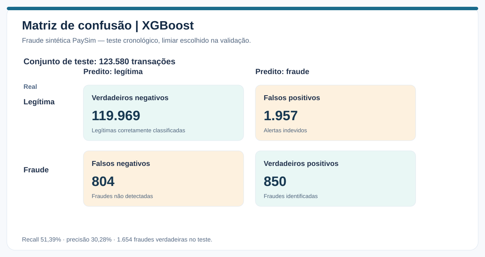
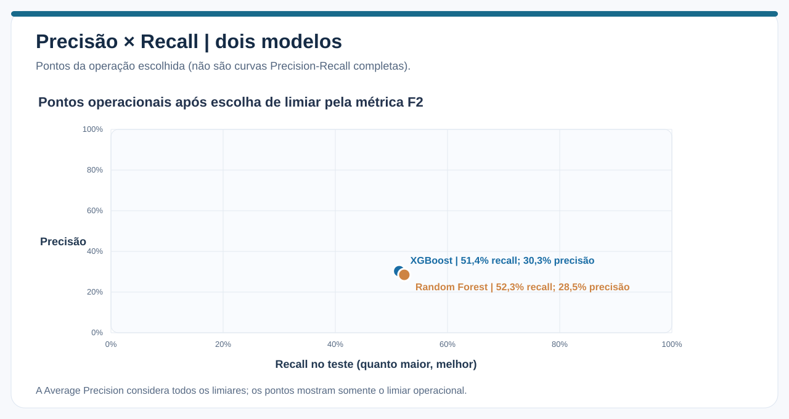
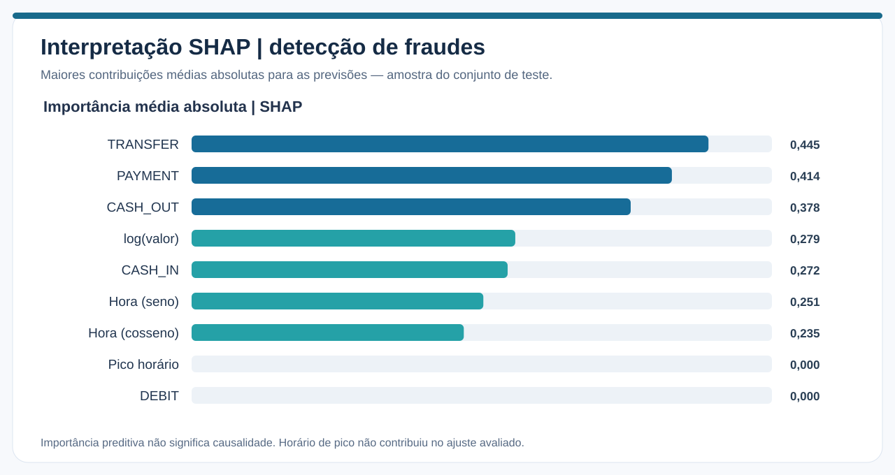

# Detecção preditiva de fraudes em transações financeiras simuladas

> **Pergunta de negócio:** quais características se associam à fraude no PaySim e quanto do risco é detectado pelo modelo, especialmente em horários de pico?

**Fonte:** [PaySim — Synthetic Financial Datasets for Fraud Detection](https://www.kaggle.com/datasets/ealaxi/paysim1). O arquivo contém **6.362.620 transações**, **8.213 registros rotulados como fraude**, e **743 etapas horárias simuladas**. O dataset **não representa fraude real** nem possui datas históricas comparáveis ao Banking. Os valores monetários são simulados e **não podem ser somados com INR**.

## Frequência dos eventos

| Tipo de operação | Transações | Fraudes | Taxa de fraude |
|---|---:|---:|---:|
| TRANSFER | 532.909 | 4.097 | 0,7688% |
| CASH_OUT | 2.237.500 | 4.116 | 0,1840% |
| CASH_IN | 1.399.284 | 0 | 0% |
| DEBIT | 41.432 | 0 | 0% |
| PAYMENT | 2.151.495 | 0 | 0% |

A prevalência total é **0,1291%**. Todas as fraudes rotuladas pelo simulador ocorrem em **TRANSFER** e **CASH_OUT**; esse detalhe cria um atalho estatístico que pode não se reproduzir em bancos reais.

## Avaliação cronológica

O notebook divide o PaySim por **etapas temporais**, e não por amostragem aleatória. Os tamanhos dos conjuntos refletem a distribuição irregular de transações por etapa:

| Conjunto | Transações | Fraudes | Prevalência aproximada |
|---|---:|---:|---:|
| Treino | 6.010.937 | 5.007 | 0,0833% |
| Validação | 228.103 | 1.552 | 0,6804% |
| Teste | 123.580 | 1.654 | 1,3384% |

A prevalência no teste é aproximadamente **16 vezes** a do treino: existe **mudança de distribuição temporal**, de modo que calibração e comparação entre modelos exigem cautela. Para reduzir custo computacional, o treinamento utilizou amostragem de transações não fraudulentas com ponderação; a validação e o teste preservam suas prevalências observadas.

### Desempenho

| Métrica | XGBoost | Random Forest |
|---|---:|---:|
| ROC-AUC | **0,9408** | 0,9338 |
| Average Precision (AP) | **0,3580** | 0,3279 |
| Precisão | **30,28%** | 28,47% |
| Recall | 51,39% | **52,30%** |
| F1 | **0,3811** | 0,3687 |
| F2 | **0,4510** | 0,4480 |
| Verdadeiros positivos | 850 | 865 |
| Falsos positivos | 1.957 | 2.173 |
| Falsos negativos | 804 | 789 |

**Interpretação:** na amostra de teste, o XGBoost sinalizou 2.807 transações e encontrou 850 fraudes; outras 804 não foram detectadas. Uma precisão de **30,28%** significa que quase 70% dos alertas foram incorretos, enquanto recall de **51,39%** significa que 48,61% das fraudes não foram detectadas.

A AP de 0,358 é superior à referência de prevalência do teste (cerca de 0,0134), mas não significa precisão de 35,8% em um único limiar. O gráfico acima representa **pontos de operação**, e não curvas Precision-Recall completas — somente a AP e os pontos estão disponíveis nas tabelas consolidadas.

O limiar foi escolhido por **F2 na validação**, privilegiando detecção em relação à precisão. Esse ajuste melhorou recall em comparação com o primeiro teste, à custa de mais falsos alarmes.

## Desempenho por horário de pico

| Métrica | Fora do pico | Horário de pico |
|---|---:|---:|
| Transações | 77.421 | 46.159 |
| Fraudes | 1.242 | 412 |
| Prevalência de fraude | 1,60% | 0,89% |
| Precisão do XGBoost | 29,21% | 46,78% |
| Recall do XGBoost | **62,00%** | **19,42%** |

Os horários de pico são definidos pelos horários do dia com maior volume agregado **no treino**. Isso não representa necessariamente um pico excepcional de volume em tempo real. O desempenho do classificador **caiu expressivamente em recall** nos horários marcados como pico, e a feature `horario_pico` apresentou importância SHAP igual a zero no ajuste avaliado.

Isso **não prova** que picos causam menos fraude; demonstra apenas que a definição de pico utilizada não acrescentou informação preditiva relevante.

## Faixas de valor e tipos

No quartil superior de valor transacional (Q4) ocorreram **1.112 das 1.654 fraudes do teste**, correspondendo a aproximadamente **67,2%** delas. As taxas de fraude variaram de cerca de **0,17% no Q1** a **3,60% no Q4**. No teste, o recall foi aproximadamente **58,89% em CASH_OUT** e **43,89% em TRANSFER**.

Essas associações são propriedades do simulador; não se deve inferir causalidade nem aplicar o modelo em produção sem dados reais, novas salvaguardas e monitoramento.

## Interpretabilidade SHAP

As maiores importâncias médias absolutas ocorreram para as categorias `TRANSFER`, `PAYMENT`, `CASH_OUT`, valor transacional e atributos de hora. Uma categoria sem fraudes, como `PAYMENT`, pode ter importância alta por **reduzir** a previsão de risco. SHAP descreve contribuições no modelo, não a causa de uma fraude.

## Problema metodológico pendente

O código comparou os dois modelos **pelo AP do conjunto de teste** para escolher o modelo final. Isso contamina o caráter independente da avaliação final. O procedimento apropriado é:

1. Escolher o modelo e ajustar o limiar **somente na validação**.
2. Fixar essa escolha sem utilizar os rótulos do teste.
3. Calcular métricas de teste **uma única vez** e relatar intervalos, diferenças entre subgrupos e mudança de prevalência.

Também falta avaliar calibração, desempenho operacional de alertas e sensibilidade da definição de horários de pico. **As métricas atuais são resultados experimentais, não certificação de um sistema antifraude.**

## Reproduzir

- [Notebook 03 — execução e código](../notebooks/03_fraudes_picos_movimentacao.ipynb)
- [Métricas fornecidas pelo Colab](../assets/data/metricas_colab.json)
- [Metodologia e limitações](metodologia_limitacoes.md)
