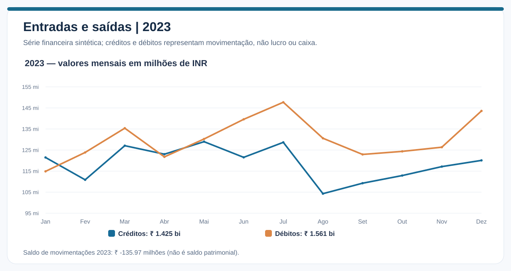
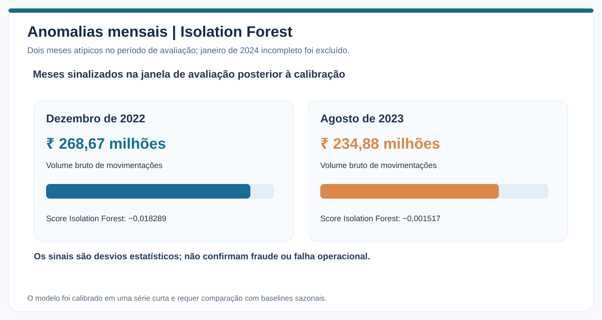

# Fluxo financeiro, sazonalidade, forecast e anomalias

> **Pergunta de negócio:** quais movimentos mensais são previsíveis e quais períodos fogem do comportamento histórico?

**Fonte:** [Banking Transactions 2019–2024 — Kaggle](https://www.kaggle.com/datasets/belbino/indian-banking-transactions-20192024). Após a limpeza e retirada de janeiro de 2024, foram estudados **60 meses completos (2019–2023)**. Entradas e saídas são **movimentações concluídas em INR**, não fluxo de caixa contábil nem saldo patrimonial da instituição.

## Entradas e saídas

Somando os valores mensais apresentados pelo Colab para **2023**, com arredondamento devido à exibição científica dos números:

| Indicador | Valor aproximado |
|---|---:|
| Créditos transacionais | **₹ 1,425 bilhões** |
| Débitos transacionais | **₹ 1,561 bilhões** |
| Diferença (créditos − débitos) | **−₹ 135,97 milhões** |

Os débitos superaram os créditos na maioria dos meses. Esses resultados **não demonstram prejuízo, falta de liquidez ou fuga real de capital**: não houve reconciliação de saldos, identificação de transferências internas nem tratamento contábil institucional.

O histórico de 2019–2023 apresenta oscilações mensais, porém sem evidência suficiente de trajetória unidirecional de crescimento ou redução. A avaliação da sazonalidade exige modelos/baselines apropriados em mais janelas.

## Modelos de previsão

O notebook compara previsão sazonal ingênua, SARIMA e XGBoost para **créditos e débitos separadamente**. Os resultados apresentados vieram de modo rápido e apenas **seis observações previstas por modelo/direção**:

| Série | Modelo | MAE aproximado | WAPE |
|---|---|---:|---:|
| Credit | SARIMA | ₹ 8,23 mi | **6,90%** |
| Credit | Naive sazonal | ₹ 8,59 mi | 7,20% |
| Credit | XGBoost | ₹ 10,28 mi | 8,62% |
| Debit | Naive sazonal | ₹ 8,58 mi | **6,49%** |
| Debit | XGBoost | ₹ 9,47 mi | 7,17% |
| Debit | SARIMA | ₹ 103,68 mi | **78,47%** |

**Créditos:** o SARIMA apresentou erro ligeiramente menor que o baseline sazonal nas janelas avaliadas, mas não há evidência robusta de superioridade sustentada. **Débitos:** a referência sazonal foi a melhor e o SARIMA mostrou instabilidade.

### Projeções históricas para 2024

| Mês | Crédito previsto | Débito previsto | Diferença prevista |
|---|---:|---:|---:|
| Jan/2024 | ₹ 120,25 mi | ₹ 114,88 mi | **+₹ 5,38 mi** |
| Fev/2024 | ₹ 102,78 mi | ₹ 123,87 mi | **−₹ 21,08 mi** |
| Mar/2024 | ₹ 121,46 mi | ₹ 135,38 mi | **−₹ 13,92 mi** |

Essas previsões foram geradas com treino encerrado em **dezembro de 2023**. São **exercícios históricos**, e não projeções atuais. Não há comparação com os três meses completos de 2024 nesse recorte. Também não foi medido separadamente o erro da **diferença** de créditos e débitos, que pode ser mais difícil de prever que os componentes isolados.

## Detecção de anomalias

O Isolation Forest foi ajustado com atributos de movimentação agregada, fluxo líquido, frequência, ticket e variação de volume. O conjunto de calibração ocupa o início da série e os períodos posteriores são avaliados como observações futuras.

| Mês | Volume bruto (aproximado) | Score Isolation Forest | Interpretação |
|---|---:|---:|---|
| Dez/2022 | ₹ 268,67 mi | −0,018289 | Combinação atípica de variáveis |
| Ago/2023 | ₹ 234,88 mi | −0,001517 | Movimentação relativamente reduzida e outras características atípicas |

Um score negativo corresponde a observação sinalizada pela configuração empregada; **não identifica fraude, erro ou perda**. O mês parcial de janeiro de 2024 foi removido e deixou de gerar um falso alerta por incompletude.

O modelo utiliza uma série curta de somente 60 observações mensais e ainda não foi comparado formalmente a baselines mais simples, como desvios sazonais robustos. Sem rótulos de anomalias verdadeiras, não há como inferir precisão/recall de detecção.

## Implicações práticas e ressalvas

- Pode-se investigar períodos de movimentação atípica, mas é necessário conhecer o contexto do negócio antes de recomendar intervenções.
- Previsões simples devem ser mantidas como referência obrigatória frente a algoritmos mais complexos.
- O SARIMA requer diagnóstico de convergência e estabilidade numérica antes de uso.
- Movimentação líquida **não** representa saldo bancário disponível e não mede liquidez real.

## Reproduzir

- [Notebook 04 — execução e código](../notebooks/04_fluxo_previsao_anomalias.ipynb)
- [Métricas observadas no Colab](../assets/data/metricas_colab.json)
- [Metodologia e limitações](metodologia_limitacoes.md)
